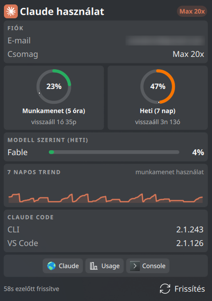

# Claude Usage Widget

A KDE Plasma 6 widget that displays your Claude Code usage statistics in the taskbar.



## Features

- **3 Panel Styles**: Ring (anti-aliased progress rings), Text (percentage + dot), Bar (vertical bars with time marker)
  
- **Panel Customization**: Metrics size (100–300%), ring center (percent, Claude logo, or logo + percent) with adjustable logo size, 5h/7d window labels, panel margin and icon size
- **Time-Proportional Coloring**: Colors based on elapsed time vs usage ratio (configurable, can switch to fixed 50/80/100% thresholds)
- **Card Popup**: Modern card-based popup with configurable card order and visibility (via settings)
  - Account info, session & weekly usage rings, per-model breakdown, extra usage, token stats, trend chart, installations, quick links
- **Classic Popup**: Traditional layout with progress bars (switchable in settings)
- **Desktop Notifications**: Alerts when usage crosses thresholds (50/80/95% session, 95% weekly, quota reset)
- **Update Checker**: Orange dot on panel icon when a new Claude Code version is available
- **Widget Update Notice**: Green badge in the popup when a newer version of the widget is on the KDE Store, opening "Get New Widgets"
- **Process Visibility**: Hide widget or usage when Claude is not running
- **Configurable Refresh**: Default 5 min polling (adjustable in settings)
- **Smart Rate Limit Handling**: Uses `retry-after` header, exponential backoff, and token watcher for automatic recovery
- **Local Cache**: Remembers last data on restart (up to 24h)
- **Stale Detection**: Widget dims when data is outdated
- **Error Handling**: Clear messages when not logged in, token expired, or rate limited
- **Custom API Support**: Optional proxy/gateway with custom base URL and API key
- **Custom Credentials Location**: Point the widget at another `.credentials.json` or Claude config folder
- **Configurable Background Opacity**: Adjustable transparency for desktop placement
- **15 Languages**: EN, HU, DE, FR, ES, IT, PT, RU, PL, NL, TR, JA, KO, ZH-CN, ZH-TW
- **No Dependencies**: Pure QML, no Python or external tools required

## Requirements

- KDE Plasma 6.0 or later
- A Claude login from **either** of these (the widget uses whichever it finds, Claude Code first):
  - Claude Code CLI, installed and logged in
  - Claude Desktop, installed and signed in (see [Claude Desktop login](#claude-desktop-login-no-cli-needed))

## Installation

### From KDE Store

1. Right-click on your panel
2. Select "Add Widgets..."
3. Click "Get New Widgets..." > "Download New Plasma Widgets..."
4. Search for "Claude Usage"
5. Click Install

### Manual Installation

```bash
kpackagetool6 -t Plasma/Applet -i claude-usage-widget.plasmoid
```

### From Source

```bash
git clone https://github.com/izll/plasma-claude-usage.git
cd claude-usage-widget
kpackagetool6 -t Plasma/Applet -i .
```

## Usage

1. Make sure you're logged in to Claude Code (run `claude` in terminal) or signed in to Claude Desktop
2. Add the widget to your panel
3. Click the widget to see detailed usage statistics

## Configuration

Right-click the widget and select **Configure...** to open the settings. They are grouped into tabs:

- **General**: language, refresh interval, notifications, update check, colors, visibility when Claude is not running
- **Panel**: style, what to show, layout, metrics size, margin, ring center and logo size, window labels, icon
- **Popup**: card or classic style, scrolling, desktop background opacity, card order, quick links
- **Account**: credentials location, automatic session refresh, custom API

### Credentials Location (optional)

By default the widget reads your OAuth credentials from `$CLAUDE_CONFIG_DIR/.credentials.json`, falling back to `~/.claude/.credentials.json` when that variable is not set — no configuration needed.

Because plasmashell does not inherit your shell environment, `$CLAUDE_CONFIG_DIR` is only visible to the widget if it was exported before your session started. If it wasn't, or if you keep your credentials somewhere else entirely, set the path explicitly:

| Setting | Description |
|---|---|
| **Credentials path** | Either the file itself, e.g. `~/work/.credentials.json`, or the folder that contains it, e.g. `~/work` |

A value ending in `.json` is treated as the file; anything else is treated as the Claude config folder and `/.credentials.json` is appended. A leading `~` is expanded; `$VARIABLES` inside the value are not.

That same folder is also used for the account file (`.claude.json`, for your e-mail address and plan) and for the `projects/` scan behind today's token stats, and it is passed as `CLAUDE_CONFIG_DIR` to the `claude` process started by the **Open Claude** button and by the silent session refresh — so pointing the widget at a second account moves the whole popup to that account, not just the token.

Leave the field empty to go back to the default behaviour.

### Claude Desktop login (no CLI needed)

If there is no Claude Code login, the widget falls back to the login cached by Claude Desktop, so it works the same whether you use the CLI, the desktop app, or both. When both exist, the Claude Code login is used.

Claude Desktop keeps its login in `~/.config/Claude/config.json`, encrypted with Electron's safeStorage. The widget decrypts it **read-only** with `contents/scripts/desktop_creds.sh`, which needs:

- `openssl` 3.0 or newer (present on practically every current distribution)
- if Claude Desktop stores its key in the system keyring: `secret-tool` (libsecret, GNOME Keyring and compatible) or `kwallet-query` (KWallet). KWallet may ask you once to allow access (Electron files the key under the product name, so the widget looks in both `Chromium Keys/Chromium Safe Storage` and `Claude Keys/Claude Safe Storage`); if the lookup fails or is refused the widget waits 30 minutes before asking again

Things to know:

- The widget never uses Desktop's refresh token (refresh tokens rotate, so using one would sign Desktop out). When the access token has expired the widget shows "Re-login required" with an **Open Claude** button that starts Claude Desktop, which refreshes the login itself.
- Silent session refresh only applies to the CLI login.
- Plan badge and account e-mail come from Claude Code's files and may be missing for a Desktop-only login.
- A custom **Credentials path** disables the Desktop fallback: the path you set is used as-is.
- Custom config folder: set `CLAUDE_DESKTOP_DIR` for plasmashell, e.g. in `~/.config/plasma-workspace/env/`.
- To see why no Desktop token is found (key names only, never token values):
  ```bash
  sh ~/.local/share/plasma/plasmoids/org.kde.plasma.claudeusage/contents/scripts/desktop_creds.sh --diagnose
  ```
  Adjust the path if you installed the widget elsewhere.

### Custom API Base URL (optional)

If you use a custom API proxy or gateway, the widget can skip the credentials file entirely and call your endpoint with an API key instead.

| Setting | Description |
|---|---|
| **Base URL** | Your proxy URL, e.g. `https://your-proxy.example.com` |
| **API key** | Your `ANTHROPIC_API_KEY` |

> **Note:** The widget calls `/api/oauth/usage`, not the standard `/v1/messages` endpoint. Use the root URL without any path suffix — e.g. `https://api.anthropic.com`, not `https://api.anthropic.com/v1`.

When a base URL is configured, the widget authenticates with `x-api-key` instead of the OAuth token. Leave the Base URL field empty to go back to the default credentials file method.

## How It Works

The widget calls the Anthropic usage API directly from QML. No data is stored or sent anywhere else.

### API Endpoint

```
GET https://api.anthropic.com/api/oauth/usage
Headers:
  Authorization: Bearer <oauth-token>   (default mode)
  x-api-key: <api-key>                  (custom base URL mode)
  anthropic-beta: oauth-2025-04-20
```

## Troubleshooting

### "Not logged in" error

Make sure you're logged in to Claude Code:
```bash
claude
```
or signed in to Claude Desktop. If you only use Claude Desktop and the widget still says "Not logged in", run the `--diagnose` command from [Claude Desktop login](#claude-desktop-login-no-cli-needed) to see which step fails (missing `openssl`, keyring key not readable, unexpected token format, ...).

### "Token expired" error

Your OAuth token has expired. Run Claude Code again to refresh it:
```bash
claude
```
The widget also has an "Open Claude" button for this (it starts Claude Desktop instead of the CLI when the login comes from Claude Desktop).

### "Rate limited" error

The API allows ~4 requests per 5-minute window. The widget handles this automatically:
- Reads the `retry-after` header and waits the specified time
- Falls back to exponential backoff (5/10/15 min)
- Monitors for token refresh and recovers instantly

To avoid rate limiting, keep the refresh interval at 5 minutes or higher.

### "Invalid API key" error

The API key in the widget settings is wrong or revoked. Open **Configure...** and update it.

### "Endpoint not found — check base URL" error

The base URL in the widget settings doesn't point to a valid API. Make sure you're using the root URL without `/v1`, e.g. `https://api.anthropic.com`.

### Widget shows 0%

- Click the refresh button in the popup
- Check logs: `journalctl --user -f | grep -i claude`

## File Structure

```
claude-usage-widget/
├── metadata.json              # Widget metadata
├── install.sh                 # Installation script
├── contents/
│   ├── config/
│   │   ├── config.qml         # Settings tabs
│   │   └── main.xml           # Configuration schema
│   ├── scripts/
│   │   ├── fetch_usage.sh     # Usage API call (curl subprocess)
│   │   ├── desktop_creds.sh   # Read-only reader for the Claude Desktop login
│   │   └── silent-refresh.sh  # Token refresh through the claude CLI
│   ├── ui/
│   │   ├── main.qml           # Core logic, data, API
│   │   ├── CompactView.qml    # Panel representation (text/bar/ring)
│   │   ├── FullView.qml       # Card popup with drag & drop
│   │   ├── UsageRing.qml      # Anti-aliased progress ring component
│   │   ├── ModelRow.qml       # Model breakdown row component
│   │   ├── TrendChart.qml     # 7-day trend chart component
│   │   ├── configGeneral.qml  # Settings: General tab
│   │   ├── configPanel.qml    # Settings: Panel tab
│   │   ├── configPopup.qml    # Settings: Popup tab
│   │   ├── configAccount.qml  # Settings: Account tab
│   │   └── Translations.qml   # i18n (15 languages)
│   └── icons/
│       ├── claude.svg         # Claude logo (orange)
│       └── claude-tile.svg    # Claude tile icon
└── screenshots/               # Preview images
```

## License

GPL-3.0-or-later

## Author

izll

## Changelog

See [CHANGELOG.md](CHANGELOG.md) for a detailed version history.
